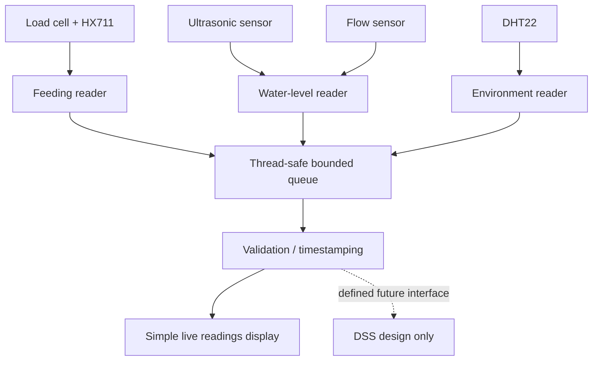
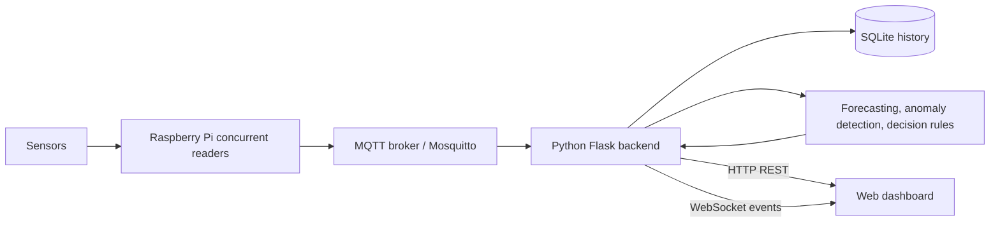

# Agresta — System Architecture and Integration Plan

**Architecture status:** Planned. This page describes Phase 1 boundaries and Phase 2 deployment.

## Phase 1 core

## Planned Phase 2 expansion

## Roles of high-level protocols
- **MQTT:** Publish timestamped telemetry from device to backend through broker.
- **HTTP:** Read history, farm configuration, and acknowledge alerts via API.
- **WebSocket:** Push current measurements and alerts to an open web session.

## Logical components / owners
| Component | Owner | Contract |
|---|---|---|
| Feeding reader | Member 2 | Sensor readings conform to shared schema |
| Water level + flow reader | Member 3 | Separate measurements, correct units and calibration metadata |
| Environment reader | Member 4 | Valid temperature/humidity readings at supported interval |
| Concurrent acquisition | Member 4 + Member 1 | Queue-driven reader orchestration with stop/recovery semantics |
| Architecture / integration | Member 1 | Unified contracts, mocks, integration tests, documentation |
| Decision-support design | Member 5 | Expected inputs, future outputs, rules and evaluation plan |

## Key decisions and dependencies
1. **One sensor record per measurement** rather than a combined record requiring all sensors to sample at once. Each has UTC timestamp, device ID, sensor ID, metric, unit and quality.
2. **Do not assume water lost equals animal consumption.** Tank refills, leaks and spills must be considered.
3. **No arbitrary GPIO pin numbers yet.** Agree pinout after confirming Raspberry Pi model, sensor versions, shared ground, 3.3 V interface, and the TA's multithreading template.
4. **Mock integrations are software-only.** Physical Phase 1 assessment still needs working real sensors.
5. **Local-first deployment.** Phase 1 uses an available Raspberry Pi for acquisition and a simple display. Phase 2 adds local broker/backend/database/dashboard.

## Integration checkpoints
- **Checkpoint A:** All members agree to the schema in `docs/architecture/sensor_contract.md`.
- **Checkpoint B:** Mock integration passes validation tests without Pi hardware.
- **Checkpoint C:** Sensors demonstrate independently on Raspberry Pi.
- **Checkpoint D:** Real drivers run concurrently under the course template, with display and fault tests.
- **Checkpoint E:** Phase 1 slides/notes contain DSS plan and architecture.
